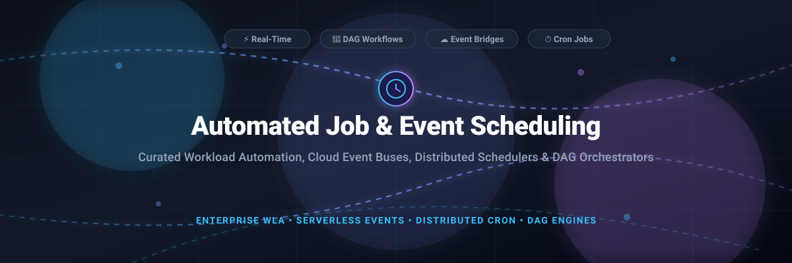

  

# ⏱️ Awesome Automated Job & Event Scheduling

  
  
  
  
  
  
  

> 🚀 A curated directory of battle-tested automated job schedulers, event-driven orchestration platforms, enterprise workload automation (WLA / SOAP) tools, distributed cron systems, and cloud event buses.

---

## 📑 Table of Contents
- [🌐 Sector Overview & Market Dynamics](#-sector-overview--market-dynamics)
- [💼 SaaS & Commercial Workload Automation Platforms](#-saas--commercial-workload-automation-platforms)
- [🔓 Open-Source Schedulers & Orchestration Engines](#-open-source-schedulers--orchestration-engines)
- [⭐ Star History](#-star-history)
- [💖 Support & Contributing](#-support--contributing)
- [📜 License](#-license)

---

## 🌐 Sector Overview & Market Dynamics

The global workload scheduling and automation (WLA / SOAP) market is valued between **$4.5 billion and $6.8 billion** and is growing at an estimated CAGR of **6% to 8%**. The market structure is **moderately fragmented**: while a vast long tail of open-source tools and niche SaaS startups cater to developer-centric cron and workflow needs, the enterprise tier exhibits strong concentration at the top where five to six major software conglomerates (such as Amazon, Broadcom, BMC Software, Fortra, and Redwood Software) control roughly half of the total market revenue.

---

## 💼 SaaS & Commercial Workload Automation Platforms

| Platform | Company Valuation / Revenue 🏢 | Starting Price 💳 | Free Tier Limits 🎁 | Primary Focus 🎯 |
|---|---|---|---|---|
| **[AWS EventBridge](https://aws.amazon.com/eventbridge/)** | **~$2.7 Trillion** Market Cap (~$790B TTM Revenue) | **$1.00 / million events** (Custom Event Bus) | **14,000,000 invocations/month** free (EventBridge Scheduler); AWS service management events free | Serverless cloud event bus and scheduled invocation router |
| **[Automic SaaS](https://www.broadcom.com/products/software/automation/automic)** (Broadcom) | **~$1.5 Trillion** Market Cap (~$89B TTM Revenue) | **Quote-based subscription** ($1,145,359/license perpetual list on CDW) | **No public free tier**; Evaluation available via assisted PoC / enterprise demo | Enterprise hybrid cloud workload orchestration and automation |
| **[Control-M](https://www.bmc.com/it-solutions/control-m.html)** (BMC Software) | **~$8.3 Billion** Valuation (~$2B Annual Revenue) | **$2,400 / month** (billed annually for SaaS Starter Pack) | **14-day free trial** (for on-prem/software evaluation) or guided interactive sandbox | Enterprise workload automation, batch scheduling, and data pipeline orchestration |
| **[ActiveBatch](https://www.advsyscon.com/en-us/activebatch/)** (Redwood Software) | **~$2.5 Billion** Acquisition Valuation (~$100M–$500M ARR) | **$10,000 one-time** (Software Advice baseline) | **30-day free trial** with full platform feature access; no permanent free tier | Centralized enterprise IT workload automation and job scheduling |
| **[RunMyJobs](https://www.redwood.com/runmyjobs/)** (Redwood Software) | **~$2.5 Billion** Acquisition Valuation (~$100M–$500M ARR) | **Consumption-based quote** (priced by execution volume) | **30-day free trial** upon introductory evaluation; no permanent free tier | Cloud-native IT process automation and SAP-certified job scheduling |
| **[Tidal Software](https://www.tidalsoftware.com/)** (Redwood Software) | **~$2.5 Billion** Acquisition Valuation (~$100M–$500M ARR) | **Custom quote** (adapter- and environment-based licensing) | **30-day free trial**; no permanent free tier | Enterprise cross-platform workload automation and business application integration |
| **[JAMS Scheduler](https://www.jamsscheduler.com/)** (Fortra) | **~$500M–$800M** Revenue (Private PE-backed) | **$833 / month** (billed annually; fixed per-agent or per-job tier) | **14-day free trial** with full access to workflow scheduling features; no permanent free tier | Cross-platform enterprise workload automation and job management |
| **[Stonebranch UAC](https://www.stonebranch.com/)** | **~$25M–$45M** ARR (PE-backed by EMH Partners) | **Custom quote** (transaction/task-volume based licensing) | **No self-service free tier**; Guided demonstration & evaluation PoC upon request | Service orchestration and real-time hybrid IT automation |
| **[EasyCron](https://www.easycron.com/)** | Bootstrap / Indie SaaS (<$5M Revenue) | **$24 / year** (~$2/month for Individual plan) | **200 executions/day**, max 5 cron jobs, 20-min minimum interval, 5-sec timeout | Web-based cron service and HTTP webhook scheduling |
| **[Upstash QStash](https://upstash.com/docs/qstash/overall/overview)** | Venture-backed Seed/Series A (<$10M Revenue) | **$1.00 / 100k messages** (Pay-as-you-go) | **1,000 messages/day**, 1 MB max message size, 3-day log retention | Serverless HTTP-based messaging and task scheduling |

---

## 🔓 Open-Source Schedulers & Orchestration Engines

Ranked by GitHub popularity and community adoption:

| Project | GitHub_Stars ⭐ | Language 💻 | Key Architectural Highlights ⚡ |
|---|---|---|---|
| **[Apache Airflow](https://github.com/apache/airflow)**  | ~47.4k | Python | Industry-standard distributed workflow authoring platform. Programmatic DAG definitions in pure Python, extensive plugin ecosystem, and deep data stack integrations. |
| **[Kestra](https://github.com/kestra-io/kestra)**  | ~30.0k | Java | Infinitely scalable event-driven orchestrator. Declarative YAML workflows with embedded code runners (Python, Node, Bash, SQL, Docker) and real-time UI. |
| **[Celery](https://github.com/celery/celery)**  | ~29.0k | Python | Asynchronous task queue and job scheduler based on distributed message passing. Ideal for real-time background task execution and recurring cron tasks (Celery Beat). |
| **[Prefect](https://github.com/prefecthq/prefect)**  | ~24.1k | Python | Modern workflow orchestration with dynamic task graphs, native async support, automated retries, and hybrid execution architecture. |
| **[Temporal](https://github.com/temporalio/temporal)**  | ~23.9k | Go | Durable execution platform guaranteeing resilient state management, distributed cron execution, failure recovery, and event-driven microservice coordination. |
| **[Argo Workflows](https://github.com/argoproj/argo-workflows)**  | ~17.1k | Go | Cloud-native container-based workflow engine for Kubernetes. Each task executes in its own pod, supporting DAGs, step workflows, and cron-scheduled jobs. |
| **[Dagster](https://github.com/dagster-io/dagster)**  | ~16.4k | Python | Cloud-native data orchestrator built for software-defined assets, data versioning, observability, declarative automation, and scheduled pipelines. |
| **[go-co-op/gocron](https://github.com/go-co-op/gocron)**  | ~7.2k | Go | Fluent, embeddable in-process Go job scheduling library supporting cron expressions, customized intervals, and distributed execution locking. |
| **[Rundeck](https://github.com/rundeck/rundeck)**  | ~6.4k | Java / Groovy | Enterprise runbook automation, self-service operations console, and incident management scheduler across heterogeneous server fleets. |
| **[ouqiang/gocron](https://github.com/ouqiang/gocron)**  | ~6.3k | Go | Distributed timed task management system with Web UI, second-level scheduling precision, HA via database-lock leader election, and multi-node worker agents. |
| **[Dagu](https://github.com/dagucloud/dagu)**  | ~4.4k | Go | Declarative YAML-based DAG workflow engine. Single lightweight binary with zero database dependencies, built-in Web UI, Docker/SSH execution, and cron triggers. |
| **[cronn](https://github.com/umputun/cronn)**  | ~120 | Go | Extended standalone cron service with customizable templates, Telegram/Slack alerts, automatic retries, and conditional execution under system load. |

---

## ⭐ Star History

---

## 💖 Support & Contributing

Thank you for visiting and using this awesome collection! 🌟

If you found this repository helpful, please consider showing your support:
- ⭐ **Star** this repository to help others discover it
- 🍴 **Fork** and contribute additions, corrections, or new scheduling tools
- 📢 **Share** with your network, team, and fellow developers
- ☕ **Buy a coffee / Sponsor** the project via the [GitHub Sponsor Dashboard](https://github.com/sponsors/ishandutta2007)

---

## 📜 License

Distributed under the [MIT License](LICENSE). Contributions and suggestions are always welcome!
